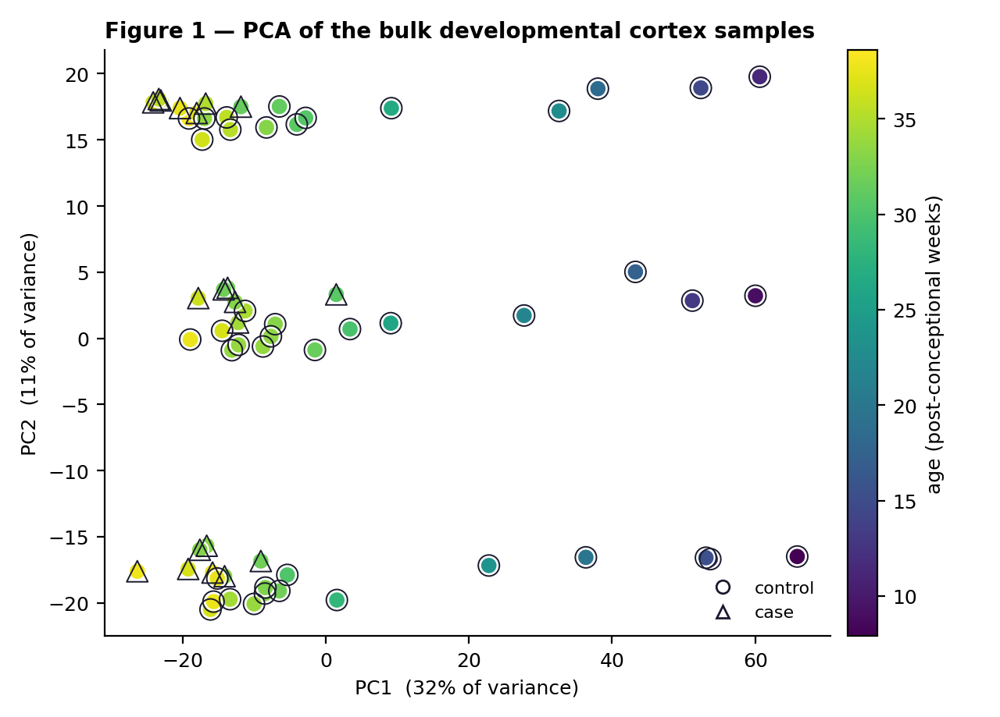
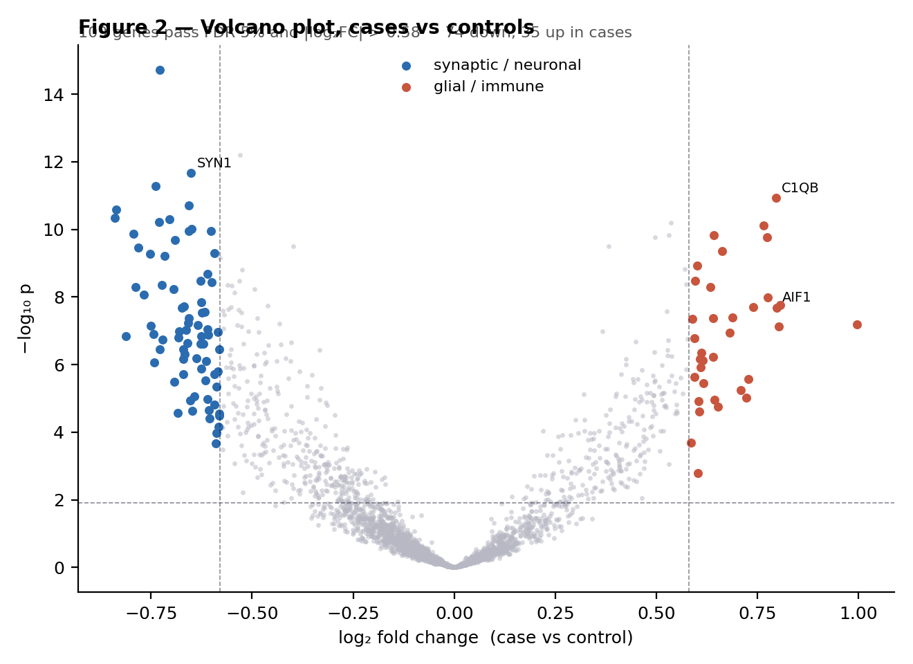
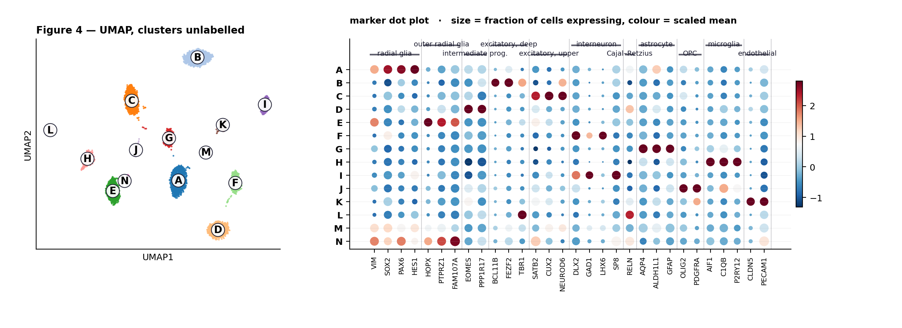
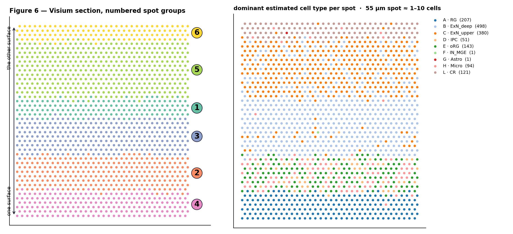

# Transcriptomic analyses in neurodevelopment

**M2 Brain Disorders · UE2 Genetics and Neurodevelopment**
Bulk RNA-seq · single-cell · spatial transcriptomics — a two-hour tutorial with continuous assessment.

[](https://colab.research.google.com/github/adrdufour/M2BD-transcriptomics/blob/main/M2BD_CC_practical.ipynb)

---

## Students — start here

**1. Click the badge above.** The notebook opens in Google Colab. You need a Google account; you do not need to install anything.

**2. Save your own copy.** *File → Save a copy in Drive.* Do this **before you run anything**, or nothing you type survives the end of the session.

**3. Run the first cell.** It takes about two minutes: it installs `scanpy` and downloads the three datasets. Start it while the setup is being explained.

**4. Work through the three blocks.** Each one ends with the figures the worksheet asks about, by number.

| Block | Time | You produce | Worksheet |
|---|---|---|---|
| **A** — bulk RNA-seq | 15 min | Figure 1, Figure 2 | Q1, Q2 |
| **B** — single-cell | 25 min | Figure 3, Figure 4 | Q3, Q4 |
| **C** — spatial + integration | 20 min | Figure 5, Figure 6 | Q5, Q6, Q7 |

**Answer the worksheet as you go.** The last ten minutes are not enough for seven questions.

You are marked on how you read your own figures, on the alternative explanation you ruled out, and on the limitation you name — **not on whether your code ran**. If a cell fails, move on: [`handout/CC_figures_handout.pdf`](handout/CC_figures_handout.pdf) has all six figures and lets you answer every question without a working runtime.

### If something breaks

| Problem | What to do |
|---|---|
| The install cell fails | *Runtime → Restart session*, then run it again. |
| The download fails or the network is blocked | Nothing to do — the notebook rebuilds the identical data locally in about five seconds and prints `built locally`. |
| A later cell errors | Skip it and keep going. Answer that question from the PDF handout. |
| You lost your work | You did not save a copy in Drive at step 2. Reopen the badge and start again — the notebook runs end to end in under four minutes. |

You may work in pairs at the keyboard. **The answers you hand in are individual.** The notebook, the lecture slides and the internet are all allowed.

---

## What is in this repository

```
M2BD_CC_practical.ipynb    the student notebook — the only file you need
data/                      the three datasets (22 MB)
handout/                   the printable worksheet and the figure handout
figures/                   reference output of the six figures
src/                       the generator and the analysis, for reproducibility
```

### The three datasets

| File | What it is |
|---|---|
| `bulk_cortex.h5ad` | 64 cortex samples × 2,747 genes. A developmental series of 24 controls from 8 to 39 post-conceptional weeks, plus an age-matched case/control contrast of 40 late-fetal samples. Raw counts, with age, region, sex, RIN, post-mortem interval and sequencing batch. |
| `fetal_cortex_sc.h5ad` | 8,000 nuclei × 2,747 genes from mid-gestation cortex. **Raw counts, no QC applied** — that is Block B's first job. Contains empty droplets, doublets and damaged cells, as any real run does. |
| `cortex_visium.h5ad` | One Visium section, 1,496 spots of 55 µm with `obsm['spatial']` coordinates. Six numbered spot groups, unannotated. |

### A word about the data

**The data is simulated.** It is simulated *from* the real biology — the cell types, the marker genes, the developmental proportion curves and the two co-expression modules all come from the literature cited in the lecture (Kang 2011, Voineagu 2011, Nowakowski 2017, Polioudakis 2019, Velmeshev 2019, Braun 2023) — but no real cohort was analysed here, and nothing you find in it is a finding.

It is built this way on purpose. All three datasets come from **one shared cell-type expression profile matrix**, so the bulk signal genuinely is

$$ y_g \;=\; \sum_k p_k \, e_{g,k} $$

and the single-cell object is genuinely a valid reference for deconvolving the bulk object. That is what makes Q5 — the keystone question — answerable with real evidence rather than by assertion. It also means every number is reproducible: the generator is seeded, so your figures match everyone else's unless you change a parameter, which the notebook invites you to do.

---

## Instructors

### Setting up

Nothing to host and nothing to configure. The notebook resolves its data in this order:

1. Download from `https://raw.githubusercontent.com/adrdufour/M2BD-transcriptomics/main/data`.
2. If that fails, or if what arrives is not an HDF5 file, rebuild locally from seed `20260904` (~5 s).

To point a fork at your own copy, edit `REPO` in the setup cell, or set `M2BD_DATA_URL` in the environment. **If you fork this under a different name, update `REPO` in the setup cell and the badge URL at the top of this README** — both hard-code `adrdufour/M2BD-transcriptomics`.

### Before the session

- Run the notebook end to end on a fresh Colab runtime the day before. It takes about four minutes. The install cell is the only one that fails in practice.
- Print `handout/CC_figures_handout.pdf`, one per student. It is what makes a failed runtime cost nobody a mark.
- Print `handout/CC_worksheet_student.docx`.
- Decide when to make this repository public. Publishing it before the session hands out the questions in advance — defensible for an open-book assessment built on reasoning, but it is a choice, so make it deliberately.

### Timing

Block B is the long pole. `cc.block_b_cluster` takes 40–60 s on a Colab CPU runtime; everything else is seconds. If you are behind, skip the `rank_genes_groups` cell — Q4 needs the dot plot, nothing else.

The cell to check on every screen while circulating is `MY_LABELS` at the end of Block B. A student who leaves it as `?` still gets a working Figure 5b — the notebook scores neuronal clusters from markers as a fallback — but has skipped the annotation step Q4 is about.

### What is deliberately not here

The answer key, the marking sheet and the expected numerical outputs are **not in this repository**, and `.gitignore` is written to keep them out. The shipped datasets are the **student build**: the columns that would answer Q4, Q5 and Q6 in a single line (`obs['true_cell_type']`, `obs['true_compartment']`, `obsm['true_proportions']`) are stripped. Rebuild the instructor version, with those columns intact, from `src/`:

```bash
python src/cc_datasets.py path/to/instructor_data --with-truth
python src/cc_pipeline.py path/to/instructor_data path/to/figures
```

`cc_pipeline.py` writes `expected_outputs.json` alongside the figures — every number the answer key refers to, checked against the ground truth. Keep it out of this repository.

### Regenerating everything

```bash
pip install scanpy leidenalg igraph reportlab openpyxl

python src/cc_datasets.py data                 # student build (default)
python src/cc_pipeline.py data figures         # the six figures
python src/build_notebook.py M2BD_CC_practical.ipynb
python src/build_handout.py figures handout/CC_figures_handout.pdf
```

`build_notebook.py` embeds `cc_datasets.py` and `cc_pipeline.py` into the notebook's setup cell, so the notebook stays self-contained. **Edit the modules in `src/`, never the notebook directly** — regenerating overwrites it.

---

## The six figures

| | |
|---|---|
|  |  |
| **Figure 1** — PCA of the developmental bulk samples | **Figure 2** — volcano, cases vs controls |
|  |  |
| **Figure 4** — UMAP and marker dot plot | **Figure 6** — Visium section, cell types per spot |

---

## Requirements

Colab needs nothing beyond a browser. Locally: Python ≥ 3.10, `scanpy`, `leidenalg`, `igraph`, `anndata`, `numpy`, `pandas`, `scipy`, `matplotlib`. Add `reportlab` and `Pillow` to rebuild the handout, `openpyxl` for the marking sheet.

## Licence and citation

Code and generated data: **MIT** (see `LICENSE`). Teaching materials: **CC BY 4.0**.
If you reuse or adapt this session, please cite it — `CITATION.cff` has the metadata.

Adrien Dufour · Inserm · <adrien.dufour@inserm.fr>
